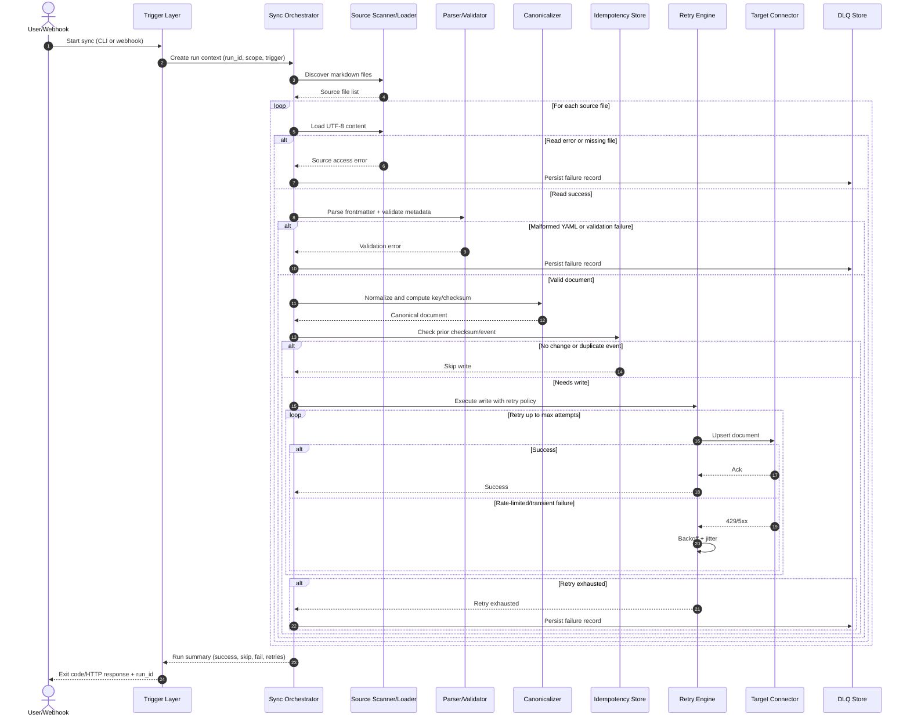

# Architecture Specification: Automated Documentation Sync

## 1. Purpose and Scope
This architecture describes the phase-1 Automated Documentation Sync pipeline, the FR-1A story-intake runtime, and the SCRUM-6 Tour Booking & Summary page in [requirements.md](requirements.md). The CLI, local SQLite sync state, webhook receiver, constrained Word story-intake runtime, and static tour page are implemented under `apps/`; their current test evidence and residual limitations are recorded in `verify.md` and `review.md`. Story intake and SCRUM-6 are separate capabilities; the tour page has no connection to sync execution.

## 2. Architecture Drivers
- Functional drivers:
  - Parse Markdown and YAML frontmatter.
  - Support full and scoped CLI sync.
  - Support webhook/event-triggered incremental sync.
  - Upsert by deterministic key with no-change skip.
- Non-functional drivers:
  - Idempotency across repeated runs and duplicate events.
  - Retry with exponential backoff and jitter.
  - Dead-letter capture for unrecoverable failures.
  - Structured logs and run metrics.
- SCRUM-6 drivers:
  - Static responsive booking presentation with the required DOM order and selectors.
  - Browser-generated PDF download and deterministic simulated failure behavior.
  - No backend, network calls, or dependency on the sync pipeline.
- Story-intake drivers:
  - Accept authorized Jira/Confluence sources or a Word document upload.
  - Normalize story content into a traceable structured record.
  - Surface incomplete, ambiguous, unavailable, or unauthorized sources without inventing requirements.

## 3. Technology Stack Choices

### 3.1 Language and Runtime
- Python 3.13 for fast iteration, strong filesystem support, and test tooling.

### 3.2 Core Libraries
- `PyYAML` for YAML frontmatter parsing.
- `FastAPI`/`uvicorn` for the provider-agnostic webhook service and `python-docx` for local Word `.docx` intake.
- `pytest` for unit, integration, and resilience tests.
- Python Playwright is used for SCRUM-6 browser integration tests; dependencies are declared in `requirements-dev.txt`.
- Standard library modules:
  - `pathlib` for path normalization.
  - `hashlib` for deterministic checksum generation.
  - `fnmatch` for include/exclude glob filtering.
  - `json`, `logging`, `time`, and `uuid` for orchestration and observability.

### 3.3 Trigger and Service Options
- CLI trigger: implemented Python module entrypoint at `apps/sync_service/main.py`.
- Webhook trigger: implemented provider-agnostic FastAPI receiver with timestamped HMAC-SHA256 verification, schema/path validation, and SQLite event deduplication in `apps/sync_service/webhook.py`. The CLI `--trigger event` flag only labels a CLI run; it is not the HTTP receiver.
- Story-intake entrypoint: local Word `.docx` intake and manual-deletion CLI under `apps/story_intake/`. Jira/Confluence connectors remain disabled because no authorized read-only credentials or scopes are configured.
- Tour UI entrypoint: implemented static HTML/CSS/Vanilla JS page at `apps/tour_booking/index.html`.

### 3.4 Storage Options
- CLI target, document checksums, and event state are stored in the same local SQLite database by `apps/sync_service/persistence/sqlite_store.py`; target upsert and checksum comparison/update share one transaction.
- The in-memory mock registry and ledgers remain available for focused tests; the CLI uses SQLite.
- The DLQ is an append-only JSONL file; each record is flushed and `fsync`ed before webhook acknowledgement.
- `SYNC_DATABASE_PATH` selects the local sync-state database; its ignored default is `.sync/state.sqlite3`. No automated backups are configured, so lost state requires a full resync.
- SQLite is a local phase-1 mock-store choice, not a production registry or distributed database.
- Normalized story records use a separate project-local `.story-intake/records.sqlite3` database, with manual deletion and no expiry. Local OS account permissions are the access boundary; no external sharing or backup is configured.

## 4. Component Architecture

### 4.1 Trigger Layer
- CLI Trigger:
  - Implemented in `apps/sync_service/main.py`.
  - Starts full or path-scoped runs.
  - Produces run context (`run_id`, scope, trigger type).
- Webhook Receiver:
  - Implemented as a provider-agnostic FastAPI endpoint in `apps/sync_service/webhook.py`; the signing secret is `SYNC_WEBHOOK_SECRET`.
  - The request uses `X-DocSync-Signature: t=<unix-seconds>,v1=<hex>`; the HMAC-SHA256 input is `<timestamp>.<raw-body>`, and timestamps outside a 5-minute tolerance are rejected.
  - Enforce a 1 MiB request-body limit and a maximum of 100 changed paths.
  - Validates the event schema and repository-relative changed paths before dispatch.
  - Deduplicates repeated events using the approved SQLite event ledger.
  - Returns success only after every path has a terminal outcome and each per-file failure is durably recorded in the DLQ. Infrastructure failures return a retryable error.
  - Authentication and payload/path validation failures return 4xx; infrastructure or persistence failures return 5xx and must not mark the event complete. Providers retry using the same event ID.

### 4.2 Orchestrator
- Coordinates end-to-end workflow for a run.
- Enforces ordering: discover -> parse -> validate -> canonicalize -> idempotency check -> write.
- Aggregates per-file and run-level outcomes.

### 4.3 Source Scanner and Loader
- Discovers `.md` files from configured source root.
- Applies include/exclude patterns.
- Loads UTF-8 content; emits source access errors for missing/unreadable files.

### 4.4 Frontmatter Parser and Validator
- Splits YAML frontmatter from Markdown body.
- Parses frontmatter into key/value mapping.
- Validates required metadata fields and types.
- If frontmatter is absent, parsing produces empty metadata and required-field validation fails that document; the orchestrator records the failure and continues with other documents.

### 4.5 Canonicalizer and Checksum Engine
- Normalizes path separators and line endings.
- Builds deterministic document key from repository id + normalized source path.
- Computes checksum from normalized content and selected metadata.

### 4.6 Idempotency and Event Ledger
- The CLI uses the SQLite-backed document target/checksum and event ledger shared in one database. Separate CLI processes observe durable document and completed-event state.
- Events are claimed transactionally. A duplicate in progress is rejected; an event stuck in `processing` can be reclaimed after the 5-minute lease. A successfully handled event reaches `completed` only after requested paths have outcomes and each per-file failure is fsynced to the DLQ. Infrastructure/persistence failures release the event for a same-ID retry.
- The sync database uses the configurable project-local ignored default described in section 3.4; state recovery is a full resync.
- Decision outcomes:
  - `create`
  - `update`
  - `no_change`
  - `failed`

### 4.7 Target Connector
- Proposed target connector contract:
  - `get(key)`
  - `upsert(canonical_doc)`
  - `delete_or_mark_inactive(key)` if source-removal behavior is later approved.
- The CLI's phase-1 mock target is `SqliteSyncState`; it implements `get`, `upsert`, `upsert_if_changed`, and `all_documents`. It does not provide delete/mark-inactive behavior.
- `MockRegistryTarget` remains an in-memory adapter for unit/integration tests. Neither adapter connects to an external production registry.

### 4.8 Reliability Subsystem
- Retry Engine:
  - Classifies transient and throttling errors.
  - Applies exponential backoff with jitter.
  - Stops at configured retry limit.
- Dead-Letter Queue (DLQ):
  - Persists unrecoverable document failures.
  - Stores `run_id`, `event_id`, source path, document key, error class, retry attempts, timestamp.

### 4.9 Observability and Reporting
- CLI output and the webhook response report run ID, counts, retries, and duration. The orchestrator emits structured JSON run/document logs with document key where computed, error class, and retry counts; secret-like values are redacted before logs and DLQ persistence.
- No external metrics exporter is configured.

### 4.10 Component Ownership and Implementation Status
- `apps/sync_service/` owns the implemented sync CLI, webhook, orchestration, scanning, parsing, canonicalization, SQLite state, retry behavior, DLQ, and test-only in-memory adapters.
- `shared/config/`, `shared/contracts/`, and `shared/errors/` own the implemented shared settings, canonical document contract, status values, and error types.
- The tour page is a separate application and does not import or call sync orchestration or connectors.
- Story intake is separate from document sync; it produces a normalized record for requirements engineering and does not write to the documentation registry.
- The repository instruction requires application code to reside under `apps/` and `shared/`. The user approved locating the SCRUM-6 page at `apps/tour_booking/index.html` rather than the root-level path in the Jira story.

## 5. Sync Flow Sequence Diagram

## 6. Retry and Dead-Letter Queue Logic

### 6.1 Retry Policy
- Retry categories:
  - HTTP 429 rate-limited responses.
  - Transient target errors (for example 5xx, timeout, connection reset).
- Non-retry categories:
  - Malformed YAML and metadata validation errors.
  - Permanent request errors caused by invalid payload shape.
- Backoff formula:
  - `delay = min(max_delay_ms, base_delay_ms * 2^(attempt-1)) + jitter`
- Default policy:
  - max attempts: 5
  - base delay: 200 ms
  - max delay: 5000 ms
- These defaults are implemented through environment-backed settings. Current jitter is uniformly selected from 0 to `max(1, base_delay_ms // 5)` milliseconds, added after applying the delay cap.

### 6.2 DLQ Record Contract
- `run_id`
- `trigger_type`
- `event_id` (if webhook)
- `source_path`
- `document_key` (if computed)
- `error_class`
- `error_code`
- `error_message`
- `attempt_count`
- `failed_at`

### 6.3 DLQ Processing
- Persist one record per unrecoverable file-level failure.
- Do not block remaining files in the same run.
- Surface DLQ count in run summary.
- Support replay workflow in later phase (out of scope for phase 1 implementation).

## 7. Data Contracts

### 7.1 Canonical Document
- `key`: string
- `repository_id`: string
- `source_path`: string
- `metadata`: object
- `content_markdown`: string
- `checksum`: string
- `version`: string

### 7.2 Required Frontmatter Fields
- `title`
- `source_path`
- `version`
- `last_updated` (ISO-8601 date or datetime)
- `doc_id` optional when deterministic keying is enabled

### 7.3 Webhook Event
- The `/webhooks/docsync` endpoint accepts schema version `1`, whose JSON payload contains exactly `event_id`, `repository_id`, and `changed_paths`; the protocol version is identified by the endpoint contract, not an extra payload field.
- `changed_paths` contains repository-relative paths and is limited to 100 entries; the request body is limited to 1 MiB.
- Authenticate the raw request body with the timestamped HMAC-SHA256 header and 5-minute timestamp tolerance described in section 4.1.
- Return 2xx only after all paths have terminal outcomes and failures are durably recorded. A completed duplicate event is acknowledged without repeating writes. Return 5xx for infrastructure/persistence failures and leave the event retryable; return 4xx for authentication or schema/path validation failures.

## 8. Security and Compliance Controls
- Secrets and tokens loaded from environment or secret manager only.
- Webhook HMAC secret loaded from `SYNC_WEBHOOK_SECRET`; verify timestamped signatures before orchestration. The service performs no provider API calls.
- Input and schema validation for all external trigger payloads.
- Structured logging and persisted diagnostics redact common secret-like values; diagnostics are length-bounded. This filter is conservative, not a guarantee against every possible secret format.
- Story-intake accepts only a user-provided `.docx` with labeled story fields; no Jira/Confluence API calls occur because no authorized integration is configured. A 5 MiB local input limit is an operational assumption. Normalized records are retained in a separate SQLite store until explicit deletion, with no automatic expiry; local OS account permissions are the access boundary. No automated backup or external sharing is configured.

## 9. Deployment View (Phase 1)
- One CLI process for ad hoc sync runs (implemented).
- One FastAPI webhook service process for event-triggered runs; launch with `python -m uvicorn apps.sync_service.webhook:create_app --factory --host 127.0.0.1 --port 8000`. Configure environment variables before starting; the default bind is loopback.
- Shared config via environment variables.
- Mock target adapter as default, with pluggable interface for production registry.
- The SCRUM-6 page is an independent static browser app with no server-side runtime or network integration. Its hosting/deployment method is not specified by the story.

## 10. Traceability to Requirements
- FR-1 and AC-1: Source scanner and glob filtering.
- FR-2 and AC-2: Frontmatter parser and metadata validator.
- FR-3 and AC-5: Canonical key/checksum and idempotent upsert.
- FR-4 and AC-3: CLI trigger and exit status handling.
- FR-5 and AC-4: Webhook validation and event dedup ledger.
- FR-7 and AC-6: Graceful file-level failure isolation and reporting.
- FR-8 and AC-7: Retry engine, backoff policy, and DLQ persistence.
- NFR-1 to NFR-5: Reliability, performance guardrails, observability, security, and modular maintainability.
- FR-1B and AC-0A: Isolated static page, responsive layout, semantic DOM ordering, and prevented form navigation.
- FR-1C and AC-0B: Browser-only Blob/object-URL download flow and inline simulated-error handling.
- FR-1A and AC-0: Local `.docx` intake, labeled-field normalization/validation, separate SQLite record output, and explicit unavailable-integration response for Jira/Confluence.

## 11. Remaining Decisions and Limitations
- Production registry connector and external-target durability are out of scope; SQLite is a local mock target only.
- Source removal behavior (delete versus mark inactive) is not implemented.
- File processing is sequential; parallelism/concurrency tuning is not implemented.
- Static hosting/deployment remains out of scope unless separately approved.
- Configure and authorize read-only Jira/Confluence integrations before enabling those sources; they are not called in this delivery.
- Sync and story database backups are not configured. Local state loss requires resync or manual re-intake.

## 12. SCRUM-6 Browser Application

### 12.1 Boundary and Components
- The page is an independent static browser application. It has no server-side API, sync-pipeline dependency, persistent state, or network calls for booking or brochure behavior.
- The implemented page has a booking-form region and a right-side panel region containing Tour Summary, Download Brochure, then Support; a centered footer follows the page content.
- The panel elements remain in that order in the DOM. Responsive CSS changes the layout to one column without reordering those elements.
- The booking form submit handler prevents the browser's default navigation/reload. The booking fields, Tour Summary, Support, and footer are presentation-only.
- The brochure component owns the card title, enabled download button, persistent helper text, and conditional inline alert in that top-to-bottom order. Its click handler clears any prior alert synchronously, checks `URLSearchParams`, and either reports the simulated failure or performs the local download flow.

### 12.2 Download and Failure Flow
1. On a normal click, create a Blob with MIME type `application/pdf`, create an object URL, create a temporary anchor with the required download filename, and programmatically click it.
2. After the anchor click, schedule object URL revocation for 100 milliseconds later. No new window is opened.
3. If `simulate_error` is exactly `true`, bypass Blob creation and download and show the required inline alert. The next click clears the alert before checking the query parameter, which causes the alert to reappear while the parameter remains set.
4. If browser download setup fails, surface an inline alert rather than silently reporting success. No network fallback is permitted.

### 12.3 File Placement and Status
- Implemented at the user-approved application path `apps/tour_booking/index.html`, replacing the story's root-level location to comply with repository code boundaries.
- The page uses plain HTML, CSS, and Vanilla JavaScript with no front-end framework, backend, or network calls. Python Playwright is used only for browser integration tests.

## 13. Story Intake Runtime

### 13.1 Boundary and Flow
- Story intake is a product runtime capability, as confirmed by the user, and is separate from the sync service and target registry.
- Implemented application boundary: local Word `.docx` CLI under `apps/story_intake/`; normalized-story contract is under `shared/contracts/story.py`.
- The local source adapter accepts a user-provided `.docx` with labeled fields (`source_reference`, `title`, `description`, `actors`, `goals`, `acceptance_criteria`, `assumptions`, `open_questions`). It does not infer a field from unlabeled text. A 5 MiB maximum file size is an operational assumption.
- Jira/Confluence intake returns an explicit unavailable-integration error; no connector implementation or external API call is included, even if credentials are present.
- The intake workflow extracts the labeled source reference, title, description, actors, goals, acceptance criteria, assumptions, and open questions; it then checks for missing or ambiguous information.
- If a source is unavailable or unauthorized, return an explicit access/dependency failure. If story details are incomplete or ambiguous, request clarification and do not produce a success-shaped normalized record.
- A successful intake produces a structured record for downstream requirements engineering. A separate `.story-intake/records.sqlite3` database retains records until explicit deletion, with no automatic expiration. `list` and `delete` commands are provided. Local OS account permissions are the access boundary; automated backup and external sharing are not configured.
- Do not use the sync-state SQLite database for story records. Loss of story database state requires manual re-intake.

### 13.2 Trust and Failure Controls
- Validate the `.docx` extension, 5 MiB size limit, source identity, and extracted record shape before storage.
- Do not store credentials in the normalized record or logs; source credentials must use the approved secret mechanism.
- Isolate each intake request and return structured failure details without exposing sensitive source content.
- Tests cover unavailable Jira intake, incomplete/ambiguous Word content, valid intake, retention, and explicit deletion. Authorized external connector behavior remains unimplemented.
